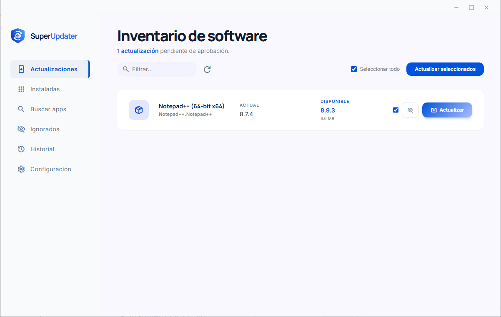
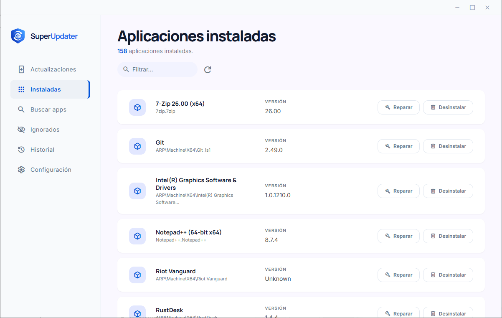
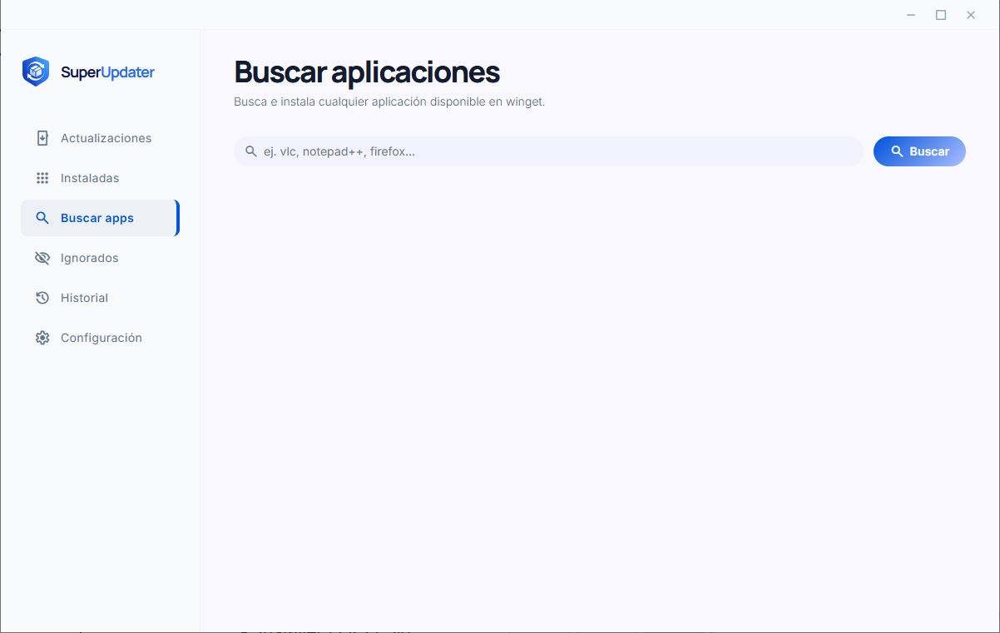
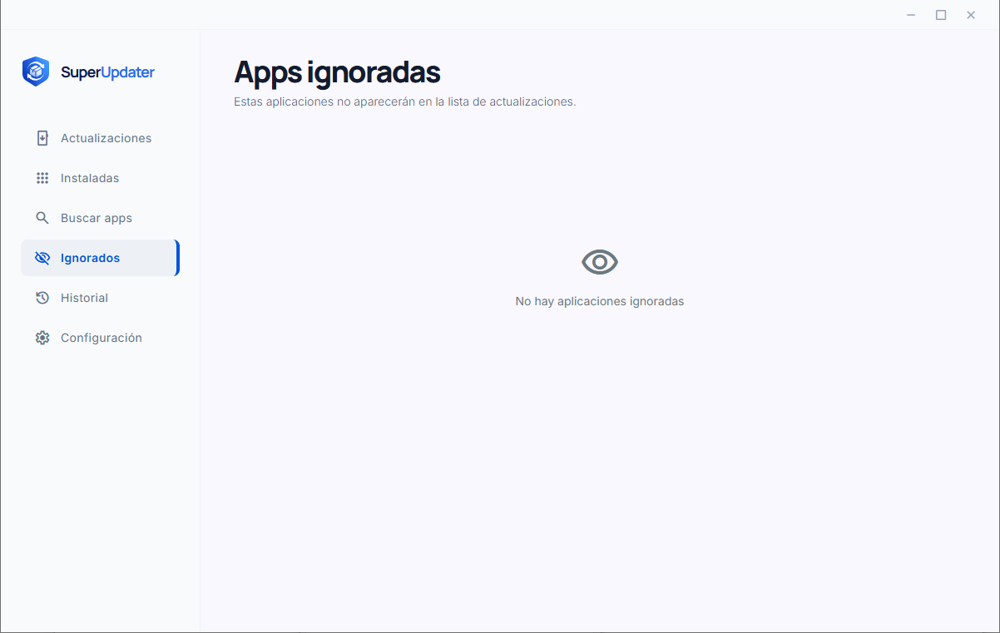
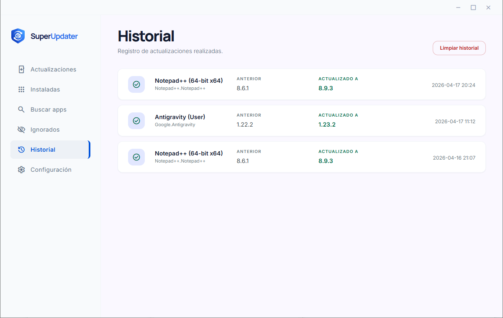
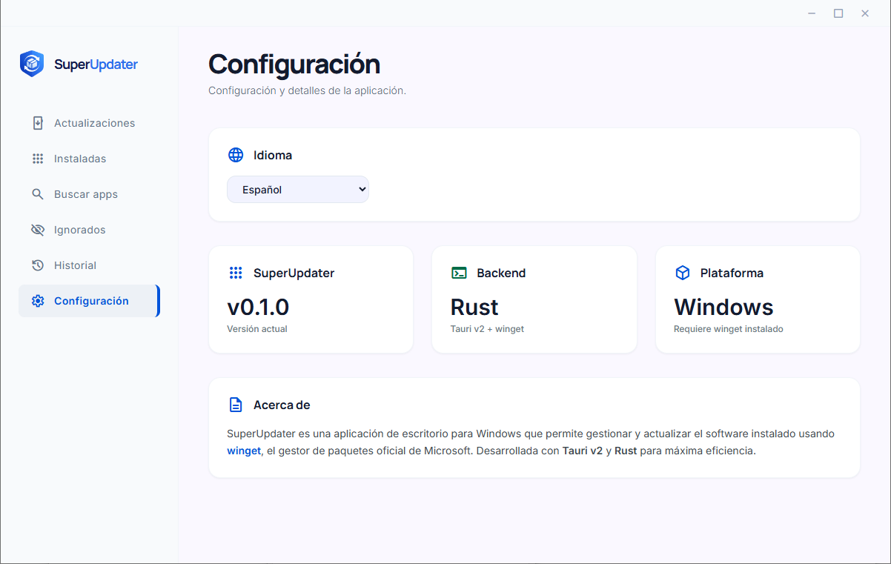
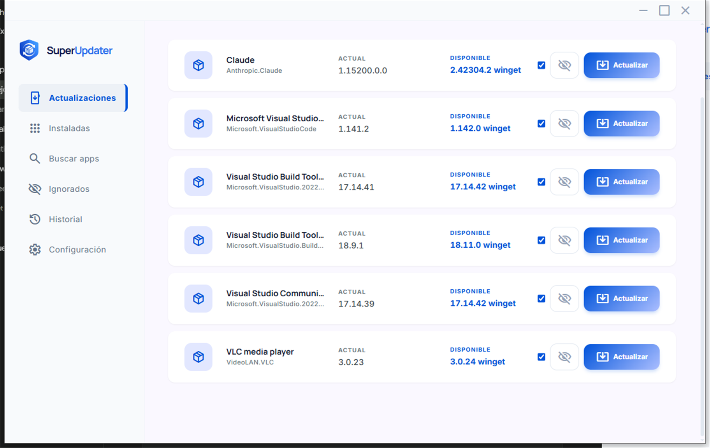
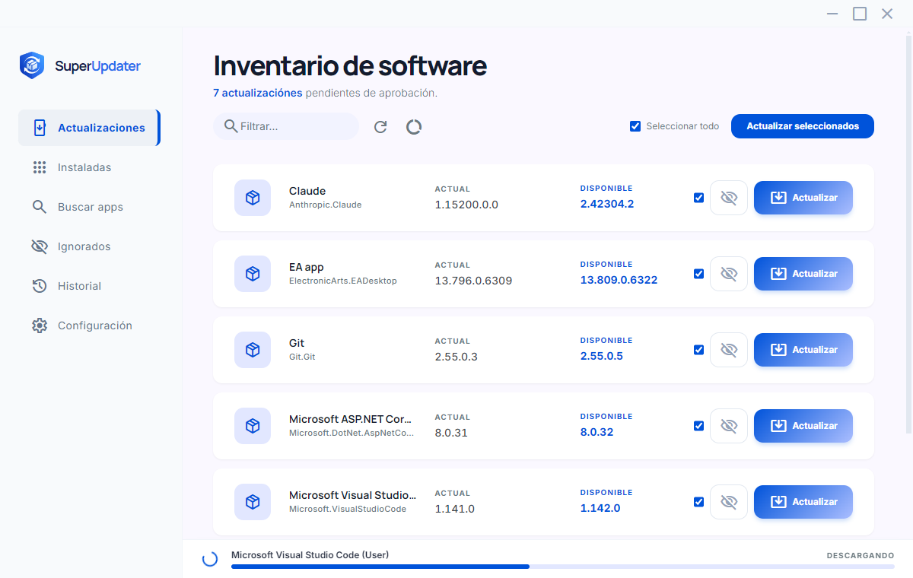
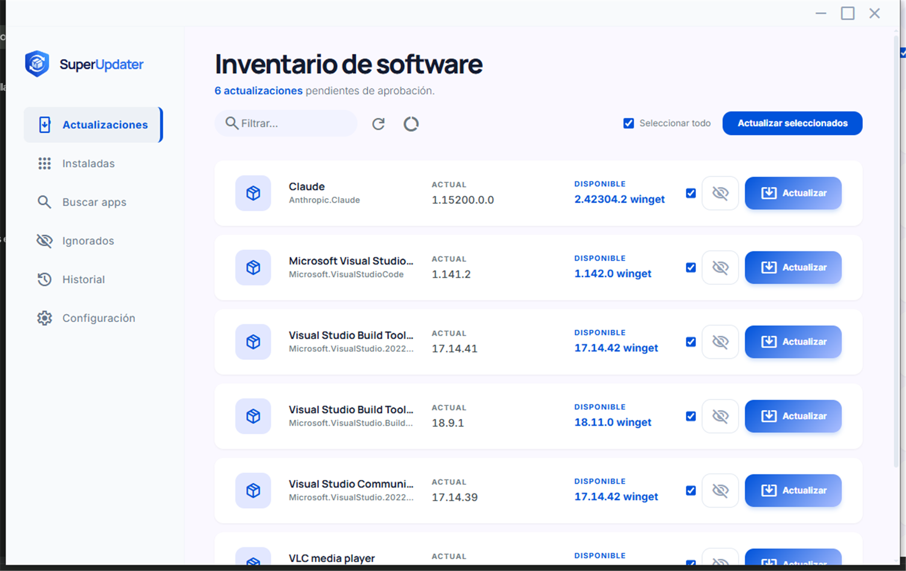

<div align="center">
  
  <h1>SuperUpdater</h1>
  <p>A lightweight Windows desktop app to manage and update your installed software using <strong>winget</strong>.</p>

  
  
  
  
</div>

---

## Features

- **Updates** — Lists all pending software updates from winget and lets you update them individually or all at once
- **Installed apps** — Browse every installed application with options to uninstall or repair
- **Search & install** — Search the entire winget catalog and install any app silently
- **Ignore list** — Exclude specific apps from the updates list permanently
- **History** — Keeps a log of every update performed with version info and date
- **i18n** — Full English / Spanish support, persisted across sessions
- **No admin required** — Installs and runs per-user

## Screenshots








<details>
<summary>Current build</summary>





</details>

## Requirements

- Windows 10 / 11
- [winget](https://aka.ms/getwinget) (the app can install it automatically if missing)

## Installation

Download the latest installer from [Releases](../../releases):

[SuperUpdater 0.1.1](../../releases/tag/v0.1.1)

Run it — no admin rights needed.

### Installer vs. portable

The build produces two artifacts in `dist/`:

| File | What it is |
|---|---|
| `SuperUpdater_0.1.1_x64-setup.exe` | NSIS installer. Installs per user (no admin), adds Start-menu and uninstall entries. |
| `SuperUpdater_0.1.1_portable.exe` | Standalone executable. Copy it anywhere and run it; nothing is installed. |

Both need the **Microsoft Edge WebView2 Runtime**, which ships with Windows 11 and
with Windows 10 1803+ via Edge. The portable build still stores its history and
ignored list in `%LOCALAPPDATA%\SuperUpdater`, so moving the executable does not
move that data.

The artifacts are unsigned, so Windows SmartScreen may ask for confirmation the
first time they run (More info → Run anyway).

## Building from source

### Prerequisites

- [Rust](https://rustup.rs/) (stable)
- [Node.js](https://nodejs.org/) 18+
- [Tauri CLI v2](https://tauri.app/start/prerequisites/)
- [Visual Studio Build Tools](https://visualstudio.microsoft.com/visual-cpp-build-tools/) with **Desktop development with C++**

### Steps

```bash
git clone https://github.com/<your-user>/SuperUpdater.git
cd SuperUpdater
npm install
npm run tauri build
```

The installer will be at:

```
src-tauri/target/release/bundle/nsis/SuperUpdater_x.x.x_x64-setup.exe
```

and the portable executable at `src-tauri/target/release/superupdaterapp.exe`.

To build both and copy them into `dist/`, named after the version in
`src-tauri/tauri.conf.json`:

```bash
powershell -ExecutionPolicy Bypass -File tools/build-release.ps1
```

It prints the size and SHA-256 of each artifact.

For development with hot-reload:

```bash
npm run tauri dev
```

## Project structure

```
SuperUpdater/
├── src/                       # Frontend (vanilla HTML + hand-written CSS)
│   ├── index.html             # Main UI
│   ├── main.js                # App logic & Tauri command calls
│   ├── i18n.js                # English / Spanish translations
│   ├── styles.css             # All styles (no CDN, no build step)
│   ├── assets/fonts/          # Self-hosted woff2 fonts
│   └── logo.png               # App logo
├── src-tauri/                 # Rust backend
│   ├── src/
│   │   ├── lib.rs             # All Tauri commands (winget wrapper) + parser
│   │   └── main.rs            # Entry point
│   ├── tests/fixtures/        # Verbatim captures of real winget output
│   ├── icons/                 # App icons (all sizes)
│   ├── capabilities/
│   │   └── default.json       # Tauri permissions
│   └── tauri.conf.json        # Tauri configuration
└── tools/
    ├── check-css-coverage.sh  # Fails if a utility class is missing from styles.css
    └── preview/               # Browser harness + live-app inspection helpers
```

## Tech stack

| Layer | Technology |
|---|---|
| Framework | [Tauri v2](https://tauri.app/) |
| Backend | Rust |
| Frontend | Vanilla JS + hand-written CSS (no CDN, no build step) |
| Fonts | Self-hosted Inter, Manrope and Material Symbols (`.woff2`) |
| Package manager | winget (Windows Package Manager) |

## How it works

The Rust backend spawns `winget` directly (no PowerShell wrapper, hidden window so
there is no console flash) and parses the tabular output by detecting the column
positions from the header line. Results are passed to the frontend as JSON through
Tauri's IPC bridge.

Persistent data (ignored apps, update history) is stored as JSON in
`%LOCALAPPDATA%\SuperUpdater\`, written atomically so an interrupted write cannot
corrupt the file.

### Parsing the winget table

winget prints a fixed-width table where each value is aligned to the column start
of its header. Some columns are separated by a **single** space (for example
`13.796.0.6309 13.809.0.6322 winget`) and some values contain spaces themselves
(`ARP\Machine\X64\Android Studio`). Splitting on whitespace therefore breaks
both cases.

The parser instead reads the header row, maps each column by *name* (so it works
the same in Spanish and English) and then extracts every value **by character
offset**. Column detection is case- and accent-insensitive: `Nombre`/`Name`,
`Versión`/`Version`, `Disponible`/`Available`, `Coincidencia Origen` (which is a
source-match column, *not* an available version) are all recognised.

The last line of the output (`18 actualizaciones disponibles.`) is rejected
because it does not look like a package identifier.

## Development

```bash
npm install
npm run tauri dev
```

### Tests

The Rust parser has a fixture-based test suite. The fixtures in
`src-tauri/tests/fixtures/` are **verbatim captures** of real `winget` output
(Spanish and English), so the tests exercise the real column layout:

```bash
cd src-tauri
cargo test --lib
```

One test (`diagnostico_winget_real`) is `#[ignore]`d because it needs winget
installed; run it with `cargo test --lib -- --ignored`.

The suite also guards the translation layer (`los_textos_con_cantidad_usan_plural`):
quantities are pluralised with the `plural()` helper in `i18n.js` instead of
gluing a letter onto the word, because Spanish does not pluralise that way
("actualización" → "actualizaciones", not "actualización" + "es").

### Frontend tooling

| Script | Purpose |
|---|---|
| `tools/check-css-coverage.sh` | Verifies every Tailwind-style utility class used in `index.html` exists in `styles.css`. The CSS is hand-written, so this catches classes that silently do nothing. |
| `tools/preview/` | A browser harness (`harness.html` + `mock-tauri.js`) that mocks the Tauri API, plus PowerShell helpers to screenshot the real app window. Useful for checking layout and spacing without rebuilding. |
| `tools/preview/cdp-eval.ps1` | Evaluates JavaScript **inside the running app** over the WebView2 debugging port (CDP). The only way to inspect states that only exist in the real WebView (real winget data, native window events). |
| `tools/preview/measure-startup.ps1` | Measures how long the app takes to become usable after launch and whether the UI stays responsive while winget is queried. |
| `tools/preview/probe-nav.js` | Measured with `cdp-eval.ps1`: reports the box of each sidebar option so their sizes can be compared in the real WebView. |

### Browser self-check

The project has no JavaScript test runner (no Node, no headless browser in the
environment), so the harness doubles as an executable spec. On load,
`tools/preview/selfcheck.js` asserts the behaviour that was previously broken
and writes the outcome to `window.__selfcheck` and the browser console:

- the Spanish and English plural forms of the update / installed counts
  (including the singular cases),
- the progress bar starts at the sidebar edge and is not covered by it,
- the toast never overlaps the progress bar,
- all six sidebar options share the same width, height and right edge (browser
  buttons shrink to their label, so without a fixed width each hover highlight
  used to be a different size),
- the pending count is painted as markup, not as text: it runs the real
  `afterRowsChanged()` path (the one executed when an app finishes updating)
  and fails if the `<span>` ends up visible. That path used `textContent` while
  the initial render used `innerHTML`, so the tags only appeared after an update.

```bash
powershell -ExecutionPolicy Bypass -File tools/preview/serve.ps1
# open http://localhost:8731/tools/preview/harness.html
# in the devtools console:
__selfcheck
# => { passed: 22, failed: 0, total: 22 }
```

`cargo test` also carries a source-level guard for the same plural bug
(`los_textos_con_cantidad_usan_plural`), so a broken plural is caught even
without a browser.

### Inspecting the running app

The harness renders the same HTML with mocked data, but it cannot reproduce
what only happens in the real WebView: the native window events, the real
winget output, the local fonts. For that, the app is launched with the
WebView2 debugging port open and inspected over the Chrome DevTools Protocol:

```bash
# 1. Launch the app with the debugging port enabled
cd src-tauri
WEBVIEW2_ADDITIONAL_BROWSER_ARGUMENTS="--remote-debugging-port=9222" \
  ./target/debug/superupdaterapp.exe

# 2. From the project root, evaluate JavaScript inside the live WebView
powershell -ExecutionPolicy Bypass -File tools/preview/cdp-eval.ps1 \
  -File tools/preview/probe.js
```

| Script | Purpose |
|---|---|
| `tools/preview/probe.js` | Scroll offsets, row count and heights, and the geometry of the title bar, sidebar, main area and progress bar. |
| `tools/preview/probe-progress.js` | Shows the real progress bar (same code path as the app) and checks that it does not overlap the sidebar. |
| `tools/preview/window-cycle.ps1` | Minimises and restores the window, and optionally resizes it, to reproduce the relayout that happens when the app is brought back from the taskbar. |
| `tools/preview/measure-startup.ps1` | Times the launch and checks that the UI thread keeps answering while winget is queried. |

Measured on this machine (debug build, 6 pending updates):

```
Process -> WebView visible : 645 ms
Process -> list drawn       : 1508 ms
UI thread alive during load: yes (16 responses while winget was queried)
```

### Startup performance

The original build loaded Tailwind from a CDN, which downloaded ~400 KB of
JavaScript and recompiled the CSS in the browser on every DOM change. With a
long list of applications that blocked the main thread for several seconds and
the app appeared frozen on launch.

Now the stylesheet is a single hand-written static file (`src/styles.css`), the
fonts are self-hosted, and nothing is fetched from the network at runtime. The
backend calls winget asynchronously with a timeout, streams its output and
reports progress through Tauri events, so the interface stays interactive while
the query runs.

## License

MIT
